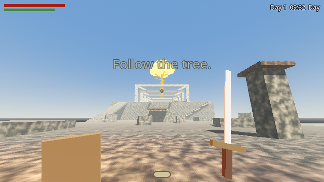
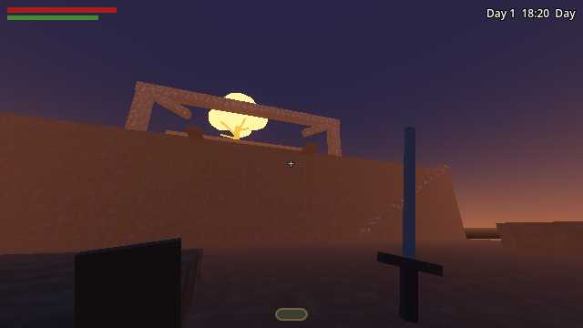
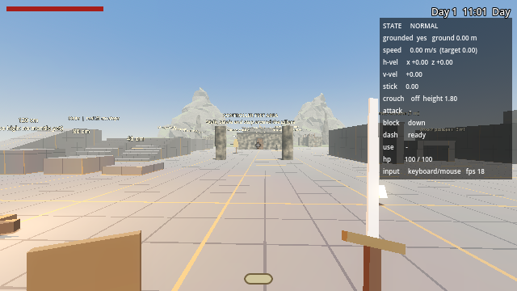
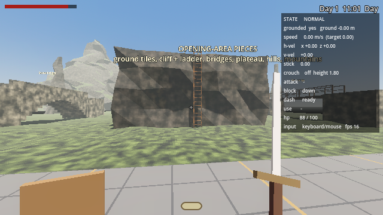
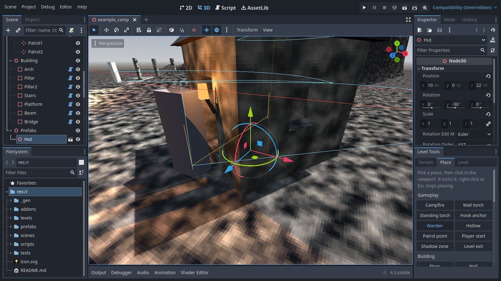

# Jeffrey Brings Death 2.0

You are Jeffrey, a peasant demon creeping up the back of a walking Colossus
toward the glowing tree on its shoulder. You are weak, and you stay weak.

This is the **first playable greybox slice**, built in **Godot 4.3**
(GDScript, no plugins). Everything is placeholder primitives with a
low-res, Thief 2-ish look: the game renders at 640×360 and is scaled up
with nearest-neighbour filtering.




## Running it

1. Install [Godot 4.3+](https://godotengine.org/download) (standard build, not .NET).
2. Open Godot, **Import**, and pick this folder's `project.godot`.
3. Press **F5**. You start in the **controller test area**
   (`levels/controller_test.tscn`): a graybox course for walking, jumping,
   crouching, dashing, fighting dummies, doors, ladders and bridges.
   The greybox Colossus slice is `scenes/greybox_slice.tscn` (open it, press **F6**).



**Combat arena:** open `scenes/play_combat_arena.tscn` and press **F6** to
fight a swordsman with sword, shield, stamina and dodge. See
[docs/COMBAT.md](docs/COMBAT.md) for how it works and how to tune it.

## Controls

Jeffrey's controller follows the first-person controller spec. Everything
about it, including every tuning value, is in [docs/CONTROLLER.md](docs/CONTROLLER.md).

| Action | DualSense | Keyboard / mouse |
| --- | --- | --- |
| Move | Left stick | WASD |
| Look | Right stick | Mouse |
| Run (hold) | L2 | Shift |
| Block (hold) | L1 | Right mouse |
| Light attack | R1 | Left mouse |
| Heavy attack | R2 | F |
| Jump | Cross | Space |
| Dash | Circle | Alt |
| Interact (doors, levers, pickups, rest at a campfire) | Square | E |
| Crouch (toggle) | Triangle | Ctrl or C |
| Rest menu: morning / evening | D-pad up / down | 1 / 2 |
| Grappling hook (greybox slice only; bites **brown wood**) | R3 | G or middle mouse |
| Debug readout | Options | F3 |
| Fullscreen / window | | F11 |
| Climb a ladder | walk into it, or Square | walk into it, or E |
| Controls overlay | Create | H |
| Debug: skip one hour | | T |
| Free the mouse | | Esc |

## What's in the slice

- **The Colossus's back**, three plateaus climbing to the tree:
  the *Haunch* (start), the *Ribs* (+12 m), and the *Shoulder* (+32 m),
  with the neck and head beyond as a dead end with a view. Fall off and you die.
- **Several ways up each cliff.** First cliff: a guarded ramp on the left,
  wooden beams to grapple on the lip, or a precarious staircase of scale ridges
  on the right. Second cliff: a long guarded ramp or a two-stage grapple chain.
- **The tree** glows through fog from everywhere. Reach its roots to end the slice.
- **Day/night cycle** (10 real minutes per day). By day you're easy to spot.
  At night you're hard to see, but **Hollows** come out: faster, sharper-eyed
  and deadlier than the Wardens.
- **Light gem** at the bottom of the HUD, as in Thief: bright means seen.
  Crouching, standing still, shadow under overhangs and night all darken it.
  Campfires light you up.
- **Wardens** patrol day and night. They notice you gradually (`?`), then hunt (`!`),
  lose you if you break line of sight, search, and give up. Three hits kill you.
  Your sword barely scratches their 260 HP (×4 on an unaware back). Don't.
- **Campfires** are checkpoints. Walking up to one sets your respawn point.
  Resting heals you, skips to morning or evening, and resets every enemy,
  Elden Ring style. Three fires: *Tailbone Fire*, *Rib Hollow*, *Shoulder Watch*.
- The Colossus occasionally takes a step and the world shudders.

## Building levels

The **Level Tools** plugin (on by default, panel under the Inspector) lets you
build levels in the editor without code: sculpt and paint terrain, carve
cliffs and ramps, click to place ground tiles, hills, cliffs, mountains,
ladders, bridges, doors, levers, campfires, torches, enemies with patrol
routes and building blocks on a snapping grid, save groups of pieces as
prefabs, and play-test from the editor. See
[docs/LEVEL_TOOLS.md](docs/LEVEL_TOOLS.md), and open
`levels/example_camp.tscn` for a worked example.




## Project layout

```
project.godot        engine settings, Input Map (rewrite with tools/write_input_map.gd)
scenes/main.tscn     the game scene; plays its Level Scene (the test area), or world.gd's greybox if empty
scenes/greybox_slice.tscn  the Colossus greybox slice
scenes/player.tscn   Jeffrey, with all his tuning in the Inspector (one node per component)
scripts/
  game.gd            autoload: clock, daylight, checkpoint
  main.gd            wiring, resting, dying, optional grappling hook
  world.gd           greybox slice layout: fires, enemies, tree
  player/            the controller: player.gd (states, health), player_input, player_movement,
                     player_camera, player_dash, player_sword, player_shield, player_interaction,
                     player_stealth, player_viewmodel, grapple_hook (add-on)
  combat/            damage_info.gd, interactable.gd, sfx.gd
  enemy.gd           Warden / Hollow stats and stealth AI
  campfire.gd        checkpoint fire
  day_night.gd       sun, moon, sky, fog
  hud.gd             bars, light gem, clock, prompts, rest menu
  debug_overlay.gd   the F3 readout
addons/jbd_level_tools/
  plugin.gd, dock.gd the editor plugin and its panel
  catalog.gd         everything on the Place palette  <- add new pieces here
  terrain/           sculptable, paintable heightmap terrain
  objects/           placeable pieces: blocks, landforms, ladders, bridges, doors, levers, dummies, ...
  materials/         materials (grass, dirt, rope, grid, hide, plate, bone, wood, ruin, rock, iron, ...)
  playtest/          the scene the Play buttons launch
levels/              controller_test.tscn (built by tools/build_controller_test.tscn), example_camp.tscn
prefabs/             saved prefabs (hut.tscn)
tools/               write_input_map.gd, build_controller_test.tscn
tests/
  controller_test.tscn   headless acceptance tests for the controller
  smoke_test.tscn        headless playtest of the greybox slice
  level_tools_test.tscn  the level tools, the new pieces and the example level
  screenshots.tscn, screenshots_test_area.tscn  render docs/screenshots
```

Enemy stats are in `enemy.gd` `KINDS`, and the day length is in `game.gd`.

## Tests

```
godot --headless --path . res://tests/controller_test.tscn
godot --headless --path . res://tests/smoke_test.tscn
godot --headless --path . res://tests/level_tools_test.tscn
```

Each prints `PASS`/`FAIL` per check and exits non-zero on failure.
The controller suite covers the spec's acceptance tests (77 checks), the
smoke test the greybox slice (stealth, enemies, grapple routes, resting,
reaching the tree), and the level tools suite every brush and palette piece
plus a playthrough of `levels/example_camp.tscn`.

The full design lives in [docs/GDD.md](docs/GDD.md).

## Not in this slice yet

Sound, real art, enemy navmesh pathing (enemies walk straight at you and stop
at edges), throwables/distractions, the Thief-style levels (Prison, Sunken City,
the party, the mansion around the tree), and saving.
