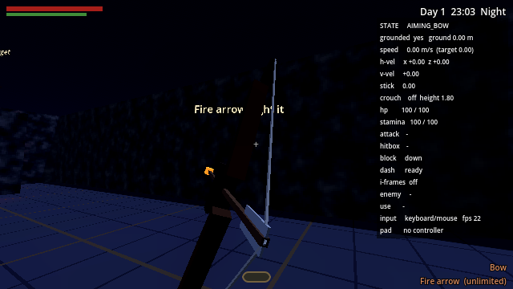
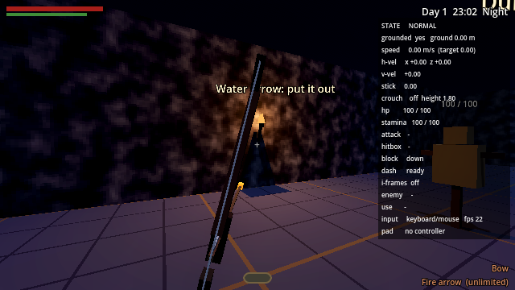
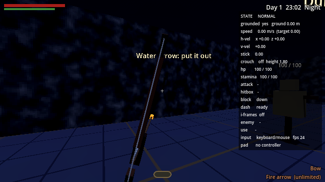

# Bow, arrows and elemental fusion

A plain bow, with arrows that can be fused with fire or water. The water
arrow is Thief's: put out a torch and the room really gets darker, so the
guards really see you less. The fire arrow is Tears of the Kingdom's:
light torches, set wood alight, start a fire that spreads and burns.



## Playing the range

Open `scenes/play_archery_range.tscn` and press **F6** (or open
`levels/archery_range.tscn` and press *Play Level*). It's night.

| Where | What to try |
| --- | --- |
| West wall | A lit torch. Water arrow it: the light goes out and your light gem darkens when you stand there |
| East wall | An unlit torch. Fire arrow it |
| Centre right | Wooden crates and straw. Fire arrow the crates; the fire spreads to the straw, which hurts anything standing in it. Water arrow puts the crates out |
| Centre left | A stone wall with a dummy behind it. Arrows clatter off stone and nothing gets through. Another dummy to shoot in the open |
| North east | A dummy on a 4 m ledge: the elevated target |
| North wall, high up | A bullseye switch. Shoot it to open the vault gate |
| North | A warden guarding the vault in torchlight. Douse its torch and sneak past, or loose an arrow off to one side and watch it go and look |

| | |
| --- | --- |
|  |  |

## Controls

| Action | DualSense | Keyboard / mouse |
| --- | --- | --- |
| Sword and shield | D-pad left | 1 |
| Bow | D-pad right | 2 |
| Hookshot / wire gun | D-pad down | 3 |
| Draw (hold) / fire (release) | R2 | Hold LMB or F |
| Aim | Right stick | Mouse |
| Cycle arrow type | D-pad up | Q or mouse wheel |
| Run | L2 (not while drawing) | Shift |

Switching takes 0.4 s (the old weapon drops, the new one rises) and you
can't attack, block or draw meanwhile. You can walk and crouch while
drawing, at 60% speed, but not run. A tap under 0.15 s lets the string
down without firing. The bottom right of the screen shows what's in hand
and which arrow is nocked.

## How it works

| Piece | File | What it does |
| --- | --- | --- |
| Loadout | `scripts/player/player_loadout.gd` | Which weapon is in hand, the switch |
| Bow | `scripts/player/player_bow.gd` | Draw, release, arrow types, the inventory |
| Arrow | `scripts/combat/arrow.gd` | The projectile: ballistic flight, hits, sticking, effects |
| Arrow type | `scripts/combat/arrow_type.gd` | A Resource per kind of arrow |
| Elemental interface | `scripts/elements/elemental_effect.gd` | One effect; `receive_element(effect)` on whatever reacts |
| Flame | `scripts/elements/flame.gd` | A real light source that fire lights and water puts out |
| Flammable | `scripts/elements/flammable.gd` | Makes its parent burn, spread, hurt, burn out |
| Arrow switch | `addons/jbd_level_tools/objects/arrow_switch.gd` | A bullseye that trips on any arrow (Level Tools: *Arrow switch*) |
| Torch | `addons/jbd_level_tools/objects/torch.gd` | Now built on the Flame component |
| Noise | `scripts/stealth/noise_event.gd` | Standard sound events, `Game.emit_noise()` |
| Effects, sounds | `scripts/elements/fx.gd`, `scripts/combat/sfx.gd` | Placeholder particles and synthesised sounds |
| Tests | `tests/bow_test.gd` | The acceptance criteria, run headless |

**Arrows are physical.** Each tick an arrow falls under gravity and casts a
ray from where it was to where it's going, so it can't skip through thin
walls at 45 m/s. It hits world geometry, enemies, and the small hit boxes
round torch flames (physics layer 5, *elemental*). It sticks into wood,
earth and bodies (and moves with them), clatters off stone and iron (any
block made of a *ruin*, *rock*, *iron* or *plate* material, or anything in
the `hard_surface` group), and stays for 20 seconds. A partial draw flies
slower and does less damage.

**The elemental interface.** An arrow never knows what a torch is. On
impact it hands an `ElementalEffect` (PHYSICAL for every arrow, plus FIRE
or WATER for fused ones) to whatever it hit and to anything in the
`elemental` group within the arrow's effect radius. Each receiver has
`receive_element(effect) -> bool` and decides for itself:

- `FlameComponent`: fire lights it, water puts it out.
- `Flammable`: fire sets it burning, water puts it out.
- `JBDArrowSwitch`: any arrow's knock trips it.
- Anything new: add a node with `receive_element`.

Damage goes through the existing `receive_damage(info)` interface, so
anything a sword can hurt, an arrow can too.

**Light and stealth.** A `FlameComponent` is an `OmniLight3D` plus a flame
mesh. While lit it's in the `light_source` group with a `light_radius`;
out, its light is switched off and it leaves the group. The light gem
(`PlayerStealth`) adds up every `light_source` near Jeffrey that has a clear
line to him (walls now block light), and the wardens and the swordsman
see further the brighter the gem. So putting a torch out really does
darken the area, really does dim the gem, and really does slow the guards'
noticing: the tests measure all three. It's still a simple model (distance
and line of sight, not real light probes).

**Noise.** Arrow impacts and the bowstring emit `NoiseEvent`s through
`Game.emit_noise()`. Wardens listen to `Game.noise_made` and go to look
when something's loud enough nearby. The bow doesn't know who hears it.

## Tuning

Select the player's **Bow** node (`scenes/player.tscn`):

| Group | Setting | Default |
| --- | --- | --- |
| Shooting | Arrow Speed | 45 m/s (full draw) |
| | Min Speed Fraction | 0.45 |
| | Arrow Gravity | 9.8 m/s² |
| | Max Draw Time / Min Draw Time | 0.8 / 0.15 s |
| | Arrow Damage | 20 |
| | Nock Time | 0.25 s |
| Handling | Draw Move Multiplier | 0.6 |
| | Draw Zoom Degrees | 8 (narrower view at full draw) |
| Arrows | Arrow Types | empty: plain, fire, water |
| Inventory | Unlimited Ammo | **on** (debug) |
| | Arrows / Fire Charges / Water Charges | 24 / 6 / 6 |

A fire or water arrow uses one arrow and one charge. Each **Arrow Type**
has: damage multiplier (water: 0.5), effect radius, colour, flight light,
how long a fire arrow keeps burning where it lands (5 s, a temporary
light), impact noise radius, and which charge it uses. Save them as
`.tres` files to make new kinds.

**Loadout** node: *Switch Time* (0.4 s), starting weapon, and which
weapons Jeffrey has.

**Torch** (in a level): *Lit*, colour, energy, range, flicker, and
whether fire can light it or water put it out.

**Flammable** (add under any object): *Burn Time* (12 s, 0 forever),
*Destroy Parent*, *Spread Radius* (2.5 m) and *Spread Delay* (2 s),
*Hazard Damage Per Second* and radius, and the flame's look and light.

## Tests

```
godot --headless --path . res://tests/bow_test.tscn
```

35 checks: switching (and no attacks mid-switch), cycling arrows and the
HUD, the minimum draw, drawing to full, walking but not running while
drawing, 45 m/s and 9.8 m/s² flight, sticking, damage (and water's
reduced damage), the elevated target, the stone wall, lighting the unlit
torch, dousing the lit one and its Light3D going off, the light gem
darkening, the warden noticing more slowly with its torch out, the
warden investigating an arrow's noise, wood catching (and plain arrows
not lighting it), fire spreading, the straw hazard, water putting a fire
out, the switch opening the gate, and the sword and shield still working
afterwards.

Not checked headless: how it looks and sounds, and aiming feel on a
controller.
