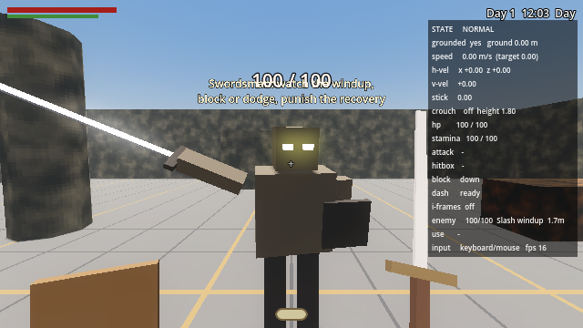
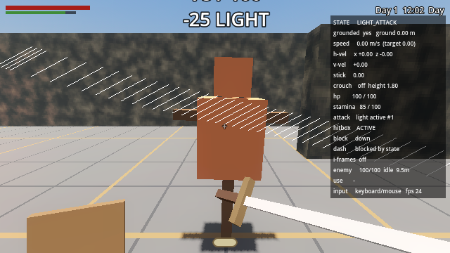

# Melee combat

Jeffrey fights like a starting Confessor in Elden Ring, seen from his own
eyes: a one-handed broadsword (lower right), a medium shield (lower left),
stamina, and a dodge. Everything is deliberate and committed. There is no
lock-on and no auto-aim, and the camera is always yours.



## Playing the arena

Open `scenes/play_combat_arena.tscn` and press **F6** (or open
`levels/combat_arena.tscn` and press *Play Level* in the Level Tools dock).

- **West:** a straw dummy for the light combo and the heavy attack, and a
  wall beside it to swing into.
- **North:** a swordsman. Watch his windup (his eyes flare and he coils
  back), block or dodge, then punish his recovery.
- **Pillars, crates and a cover wall** to strafe round and dodge behind.
- **The campfire** brings the swordsman back after you kill him (rest with E / Square).

The debug panel (F3 / Options) shows health, stamina, the combat state,
the attack phase, whether the hitbox is active, blocking and guard break,
dodge i-frames, and the nearest enemy's health and attack. While it's on,
melee hitboxes are drawn as lines: white for your sword, red for enemies.



## Controls

| Action | DualSense | Keyboard / mouse |
| --- | --- | --- |
| Light attack (three-hit combo) | R1 | Left mouse |
| Heavy attack | R2 | F |
| Block (hold) | L1 | Right mouse |
| Dodge | Circle | Alt |
| Move / look | Left / right stick | WASD / mouse |

## How it works

| Piece | File | What it does |
| --- | --- | --- |
| Sword | `scripts/player/player_sword.gd` | Light/heavy attacks, combo buffer, charged heavy, swept hitbox |
| Shield | `scripts/player/player_shield.gd` | Raise time, block arc, stamina per block, guard break |
| Stamina | `scripts/player/player_stamina.gd` | Costs, regeneration and its delay |
| Dodge | `scripts/player/player_dash.gd` | The existing dash, now with a stamina cost and an i-frame window |
| Damage interface | `scripts/combat/damage_info.gd` | One blow; anything with `receive_damage(info)` can be hurt |
| Enemy | `scripts/combat/swordsman.gd` | The humanoid sword enemy (Level Tools: *Swordsman*) |
| Enemy attacks | `scripts/combat/enemy_attack.gd` | One attack as a Resource; enemies pick from a list |
| Hitbox view | `scripts/combat/hitbox_debug.gd` | Debug lines for live hitboxes |
| Tests | `tests/combat_test.gd` | The acceptance criteria, run headless |

**Commitment.** A swing's windup and active frames always play out. You
can't block, dodge or start another attack until the blade has stopped.
From recovery, a dodge can cut a *light* attack short (Dash → *Cancels
Light Recovery*); a heavy has to be seen through. You keep 55% of your
movement and all of your camera.

**Combo.** A light press during a swing's active frames or recovery is
remembered. The next swing in the combo starts at *Combo Chain Point*
(30%) of the recovery, alternating direction, up to three. Presses during a
windup are ignored, so mashing doesn't help. A heavy pressed mid-swing
starts when the swing is over.

**Hit detection.** While the blade is active, the sword is swept along its
arc as a sphere shape cast from the eye, several samples per tick, so it
follows the visible swing and can't skip through a target. Each target is
hit once per swing. If the blade meets a wall first, the swing stops there
(with a scrape), damages nothing behind it, and still plays its recovery.

**Blocking.** The shield takes *Raise Time* to come up and only blocks once
it's fully up. It covers a 120° cone in front of you, judged from the
direction the blow travels. A block stops all the damage and costs 20
stamina. If you can't pay, your guard breaks: half the blow gets through,
the shield is knocked aside, and you can't attack or block for 1.1 s.
There is no parry.

**Dodge.** The existing dash is the dodge: a committed 3 m burst along the
stick (backward with no stick) that walls stop. You're invincible from
0.06 s to 0.20 s into it, and only then.

**The swordsman** notices you within 10 m (less if you're in the dark),
closes in, picks an attack that fits the distance, turns toward you during
the windup (but not during the swing, so a late sidestep works), swings,
recovers for 0.65 s, then circles for 0.9 to 1.8 s before trying again.
Its blade is swept along its arm's real arc. Light hits make it flinch;
50 damage inside 2.5 s (or one heavy) breaks its poise and staggers it.

## Tuning

Open `scenes/player.tscn`, select a node, and change values in the
Inspector. Hover any value for its description.

| Node | Group | Setting | Default |
| --- | --- | --- | --- |
| Sword | Light Attack | Windup / Active / Recovery | 0.18 / 0.16 / 0.32 s |
| | | Damage / Range | 25 / 2.0 m |
| | | Move Multiplier | 0.55 |
| | Light Combo | Light Chain Max | 3 |
| | | Combo Chain Point | 0.3 |
| | Heavy Attack | Windup / Active / Recovery | 0.55 / 0.20 / 0.55 s |
| | | Damage / Range | 55 / 2.2 m |
| | | Move Multiplier | 0.55 |
| | Charged Heavy | Charged Heavy Enabled | **off** |
| | | Charge Time / Charge Damage Multiplier | 0.8 s / 1.6 |
| | Hit Detection | Blade Radius / Sweep Samples | 0.18 m / 4 |
| Shield | | Raise Time | 0.15 s |
| | | Block Arc Degrees | 120° |
| | | Blocked Damage Multiplier | 0 (blocks all of it) |
| | | Move Multiplier | 0.6 |
| | Guard Break | Duration / Damage Multiplier / Knockback | 1.1 s / 0.5 / 3 m/s |
| Stamina | | Max Stamina | 100 |
| | Costs | Light / Heavy / Dodge / Block | 15 / 30 / 20 / 20 |
| | Regeneration | Regen Per Second / Regen Delay | 25 / 0.75 s |
| | Rules | Allow Partial | on: any stamina left lets you act |
| Dash | | Distance / Duration / Recovery | 3 m / 0.22 s / 0.25 s |
| | Invincibility | I Frame Start / I Frame End | 0.06 / 0.20 s |

**The swordsman:** select it in a level (or the *Swordsman* in the arena)
and change *Max Health* (100), *Notice Range*, *Move Speed*, *Pause Min /
Max*, *Poise* and *Stagger Time*. Its **Attacks** list holds `EnemyAttack`
resources: windup (0.55 s), active (0.2 s), recovery (0.65 s), damage (35),
range, reach, weight, cooldown, lunge, how hard it tracks you during the
windup, and the arm poses the swing runs between. Leave the list empty for
the two defaults (a diagonal slash and an overhead chop). To make another
enemy type, give it a different list, or save attacks as `.tres` files and
share them.

**Something new that can be hurt** only needs a method:

```gdscript
func receive_damage(info: DamageInfo) -> void:
	health -= info.amount   # info.direction, info.kind, info.source...
```

## Tests

```
godot --headless --path . res://tests/combat_test.tscn
```

They check the acceptance criteria: the three-hit combo and that presses
during a windup don't queue; stamina costs, the regeneration delay and
rate, and no attacks or dodges with none left; heavy is slower and its
windup can't be cancelled into a block, dodge or attack; 0.55 movement;
camera look mid-swing; the charged heavy; no hits through a wall; shield
raise time, frontal block, the 120° arc, side and rear blows getting
through, 60% speed, guard break and recovery; i-frames only between 0.06
and 0.20 s; dodging into walls; the swordsman noticing, approaching,
telegraphing for at least 0.5 s, pausing between attacks, being blocked
from the front and not from behind, flinching, staggering on a heavy, and
being beaten by a scripted player that only blocks windups and hits
recoveries.

They can't judge feel, sound, or a real controller. Things to try by hand:
does the windup read in time to block? Is the heavy worth its risk? Does a
guard break feel like a punishment and not a coin flip?
