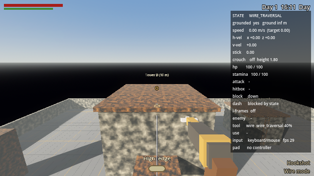
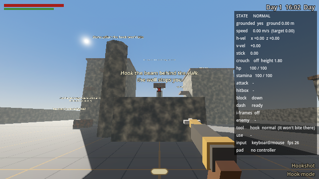
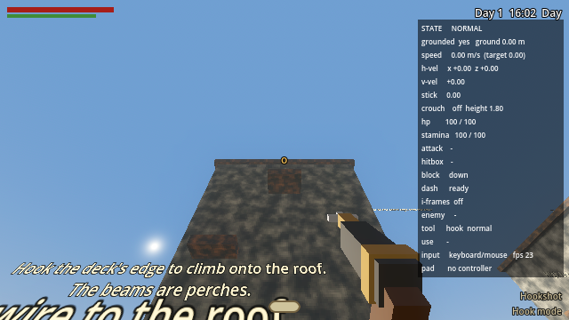
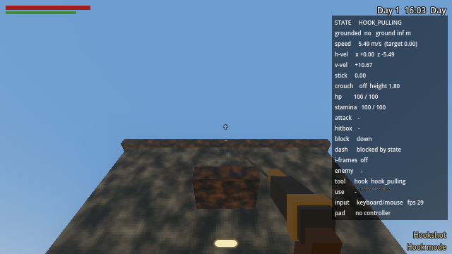
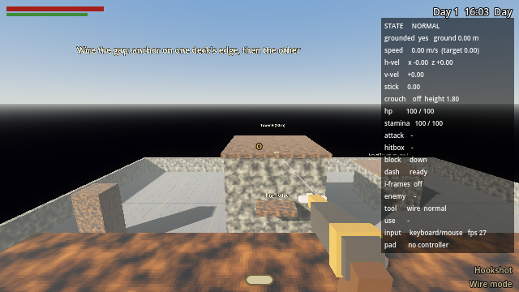

# Hookshot and wire gun

One tool, two modes. In **hook** mode it fires a hook on a cable at
anything wooden and hauls Jeffrey to it. In **wire** mode it fires two
anchors and strings a taut wire between them that he can walk across,
quietly, above the guards.



## Playing the tower yard

Open `scenes/play_tower_yard.tscn` and press **F6** (or open
`levels/tower_yard.tscn` and press *Play Level*). Press **D-pad down**
(or 3) to take out the hookshot.

| Where | What to try |
| --- | --- |
| Tower A (12 m, north west) | Hook the wooden edge of its roof deck from the yard: you're hauled up and climb onto the roof. The two beams on its face are perches |
| Between the towers | From tower A's roof, switch to wire mode, anchor near A's east edge, then near tower B's west edge. Walk across |
| Tower B (10 m, north east) | A wooden ledge on its west face to hook, and a ladder up its east face |
| Low house (east) | A 5 m wooden roof with a ladder. Wire it up to tower B's roof: a sloping wire |
| Stone pillar (south west) | Stone: the hook won't bite. The crosshair turns to an **x** |
| Wall in the courtyard | A beam behind a low wall. The hook flies over it; Jeffrey's body doesn't, so the haul stops safely at the wall |
| Posts (far north) | Two wooden posts with a stone pillar between: a wire can't go through it |
| Low beam by tower A | Too steep to wire to the roof |

| | |
| --- | --- |
|  |  |
|  |  |

## Controls

| Action | DualSense | Keyboard / mouse |
| --- | --- | --- |
| Take out the hookshot | D-pad down | 3 |
| Fire the hook / set an anchor | R2 (or R1) | F (or left mouse) |
| Switch hook / wire mode | L1 | Right mouse |
| Step onto a wire (look at the ring by its end) | Square | E |
| Walk the wire | Left stick forward / back | W / S |
| Jump off the wire | Cross | Space |
| Step off (near an end) or drop off (anywhere else) | Circle | Alt |

L1 only switches modes while the hookshot is in hand; with the sword out
it still raises the shield. The crosshair shows what the hook would do:
**o** it will bite, **x** it won't (stone, too close), **+** nothing in
range. The bottom right says which mode you're in. In wire mode, after the
first anchor, the crosshair previews whether the second one will make a
good wire, and a rejected wire says why at the bottom of the screen.

## How it works

| Piece | File | What it does |
| --- | --- | --- |
| The tool | `scripts/player/player_hookshot.gd` | Both modes, aiming, the haul, placing and checking wires, walking them |
| A wire | `scripts/traversal/tight_wire.gd` | The straight wire, its anchor bolts and its two mount points |
| Cable mesh | `scripts/traversal/rope.gd` | Stretches a thin cylinder between two points |
| Loadout | `scripts/player/player_loadout.gd` | The hookshot is the third slot |
| Noise | `scripts/stealth/noise_event.gd` | Every hookshot sound is a `NoiseEvent` |
| Level | `tools/build_test_levels.gd` | Builds `levels/tower_yard.tscn` |
| Tests | `tests/hookshot_test.gd` | The acceptance criteria, run headless |

**States.** The tool is always in one of *Normal*, *Hook Firing*, *Hook
Pulling*, *Wire Placement* (first anchor set) or *Wire Traversal*. The
player's own state follows (HOOK_PULLING, WIRE_TRAVERSAL), and while the
tool is hauling or on a wire it drives Jeffrey's movement instead of the
normal controller. Attacks, dodges and weapon switches wait.

**What bites.** Anything in the `grapple` or `hookshot` group. In Level
Tools, tick *Grapple Anchor* on a block (all the wood in the tower yard
is). Everything else (stone, iron, earth) refuses the hook and the
anchors.

**The hook.** It's a real projectile on a visible cable: it flies out at
60 m/s along the aim and checks what it reaches. Missing, hitting stone,
or hitting something under 2 m away does nothing to Jeffrey (a clink and
a spark). When it bites, the haul starts.

**The haul** moves Jeffrey with `move_and_slide` at 12 m/s toward a point
1 m out from the hook (or onto the top, if it bit the top of something).
It's never a teleport: he moves at most one tick's worth at a time, and
the camera stays fully under your control. If he stops making progress
for three ticks (a wall, a ceiling), the haul ends where he is, with no
velocity, and he drops to his feet. At the end, if there's a walkable top
within 2.2 m above and room to stand, he climbs onto it.

**Placing a wire.** R2 sets the first anchor; R2 again on another valid
surface checks the wire and strings it. The checks, in order:

1. both ends are on surfaces the hook bites;
2. 3 m to 25 m long;
3. no steeper than 30°;
4. a clear line between the anchors (it may graze the thing it's anchored
   to within 0.6 m of the bolt, nothing else);
5. room for a body standing on the wire from one end to the other (a
   capsule swept along it);
6. somewhere to step off at each end.

Only one wire at a time: a new one replaces the old.

**Walking a wire** is path following, not physics. Jeffrey's position is
a distance along the line and nothing else, so he can't drift off it or
jitter, whatever the camera does. The stick moves him along it at
1.5 m/s in the direction he's facing. Near an end he steps off onto the
ground beside the anchor; Circle steps off near an end or drops him
anywhere else; Cross jumps off. Footsteps on a wire are much quieter than
on the ground.

**Noise.** Every sound goes through `Game.emit_noise()` as a `NoiseEvent`
with a kind and a radius, so guards hear it the same way they hear
anything else:

| Event | Kind | Radius |
| --- | --- | --- |
| Firing | `hookshot_fire` | 10 m |
| The hook biting | `hookshot_connect` | 6 m |
| The hook failing | `hookshot_fail` | 6 m |
| Setting an anchor, finishing a wire | `wire_anchor`, `wire_complete` | 4 m |
| A step on a wire | `wire_step` | 1.5 m |

## Tuning

Select the player's **Hookshot** node (`scenes/player.tscn`):

| Group | Setting | Default |
| --- | --- | --- |
| Hookshot | Max Range | 20 m |
| | Pull Speed | 12 m/s |
| | Min Attach Distance | 2 m |
| | Arrival Offset | 1 m |
| | Cooldown | 0.3 s |
| | Hook Speed | 60 m/s (how fast the hook flies out) |
| | Pull Grace | 0.75 s (extra time before a haul gives up) |
| | Mantle On Arrival / Mantle Height | on / 2.2 m |
| Wire | Max / Min Wire Length | 25 / 3 m |
| | Wire Speed | 1.5 m/s |
| | Max Active Wires | 1 |
| | Max Incline Degrees | 30° |
| | Anchor Range | 20 m |
| | Mount Time | 0.35 s |
| Surfaces | Valid Groups | `grapple`, `hookshot` |
| Noise | Fire / Connect / Fail / Anchor / Wire Step Noise Radius | 10 / 6 / 6 / 4 / 1.5 m |
| | Wire Step Distance | 0.8 m between wire footsteps |

The signals (`hook_fired`, `hook_connected`, `hook_failed`,
`pull_finished`, `anchor_placed`, `wire_created`, `wire_rejected`,
`wire_mounted`, `wire_left`, `mode_changed`, `state_changed`) are there
for sounds, tutorials or anything else that wants to listen.

## Tests

```
godot --headless --path . res://tests/hookshot_test.tscn
```

The checks: equipping and switching modes (and L1 not raising a shield
with the hookshot out), the aim indicator on wood, stone and sky, a haul
up onto tower A's roof with no step bigger than one tick's pull and the
camera turning during it, the fire noise, no dodging or switching mid
haul, stone and misses not moving Jeffrey, the 2 m minimum, the wall
stopping a haul safely, both anchors, the anchor noise, the wire between
the towers, wires too long, too short, too steep, through stone and on
stone being refused, the sloping wire from the low roof, the mount
prompt, walking at 1.5 m/s with no jitter and no drift while the camera
turns, quiet steps, stepping off at the far end, walking back and
stepping off with Circle, jumping off and falling, dropping off, one
wire at a time, and the sword, shield and walking still working
afterwards.

Not checked headless: how it looks and sounds, and how it feels on a
controller.
