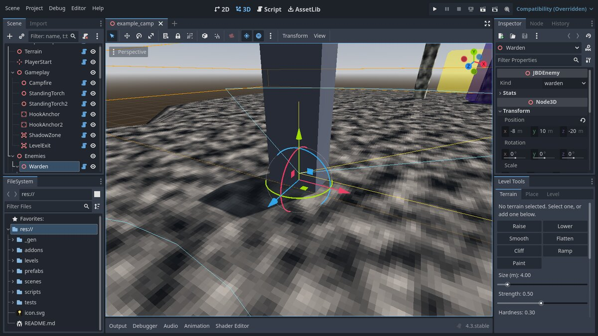
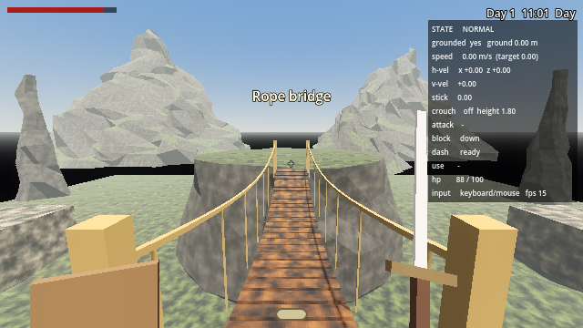

# Level Tools

A Godot editor plugin (`addons/jbd_level_tools`) for building levels by hand,
without writing code. It covers GDD section 12: terrain, gameplay objects,
enemies with patrol routes, modular building blocks, prefabs, and one-click
play-testing. Every action goes through the editor's undo history (Ctrl+Z).



The plugin is enabled in `project.godot`. If the **Level Tools** panel isn't
under the Inspector, turn it on in *Project → Project Settings → Plugins*.

## Quick start

1. **Level tab → New level**. Type a name and press *Create level*. You get
   `levels/<name>.tscn` with a 96 × 96 m terrain, a Player Start and a campfire.
2. **Terrain tab**. Pick a tool and left-drag in the viewport.
3. **Place tab**. Pick a piece and click in the viewport to drop it.
4. **Level tab → Play from Player Start** (or *Play from editor camera* to
   drop Jeffrey wherever you're looking). Pick a time of day first if you like.

Open `levels/example_camp.tscn` to see every piece in use: a camp with a hut
prefab, torches and a fire, a plateau with sheer cliffs, a carved ramp, hook
anchors on the cliff lip, a Warden patrolling the top, a Hollow below, and a
level exit behind a ruined arch.

## Terrain

Select a **Terrain** node (or add one at the bottom of the Terrain tab).

| Tool | What it does |
| --- | --- |
| Raise / Lower | Build up or dig. Hold **Shift** to do the opposite. |
| Smooth | Soften bumps and edges. |
| Flatten | Level the ground to the height where the stroke started. |
| Cliff | Snap the ground to the *Cliff height* value. Hardness 1 gives sheer walls. **Ctrl+click** picks a height from the terrain. |
| Ramp | Drag from the bottom to the top of a slope. Carves a straight ramp as wide as the brush. |
| Paint | Paint one of four texture layers. |

- **Size** is the brush radius. **[** and **]** resize it.
- **Strength** is how fast it works. **Hardness** 0 is a soft round brush,
  1 a hard edge.
- Right-click or **Esc** puts the tool down so you can select things again.
- Slopes steeper than *Cliff Angle* (Inspector, default 50°) show the Rock
  layer automatically, so cliffs read as rock without painting them.
- Layer colours, textures and names are in the Inspector under *Layers*.
  Leave a texture empty to use the game's crunchy noise.
- Heights and paint save to `<level>_terrain.res` next to the level,
  automatically after every stroke.

## Placing things

Pick a piece on the **Place** tab, then click. You keep placing until you
right-click or press **Esc**. **R** turns the piece by the *Turn step*
(Shift+R turns the other way). Pieces land on whatever is under the mouse:
blocks, terrain, or the ground plane.

- **Snap to grid** with 0.25 to 4 m steps. *Snap height too* also snaps Y.
- **Scatter**: drag to paint copies every *Spacing* metres, with random turn
  and size. Good for rocks and bone spurs.
- New pieces go into tidy groups (`Gameplay`, `Ground`, `Mountains`,
  `Bridges & Ladders`, `Building`, `Nature`, `Enemies`, `Prefabs`) under the
  level root.

After placing, use Godot's own gizmos to move and rotate, Ctrl+D to
duplicate, and Delete to remove. Change a block's **Size** in the Inspector
rather than scaling it, so its collision stays exact.

### Gameplay pieces

| Piece | Notes |
| --- | --- |
| Campfire | Checkpoint. *Fire Name* shows when you kindle it. You respawn on the blue (+Z) side. |
| Wall torch / Standing torch | Click a wall to mount a wall torch facing out of it. Colour, energy, range, shadows and flicker are in the Inspector. |
| Hook anchor | A wooden beam the grappling hook bites. Any block with *Grapple Anchor* ticked works too. |
| Warden / Hollow | An enemy post with two patrol points. See below. |
| Patrol point | Select an enemy, then click to add points to its route. |
| Player start | Where Jeffrey wakes up. Faces -Z. |
| Shadow zone | Deep shadow: dims the light gem. Set *Size* in the Inspector. |
| Level exit | Reaching it completes the level. |
| Door | Swings open with Interact. Tick *Locked* to make it a gate that a lever opens. |
| Lever | Set *Target* to a door (or anything with `activate()`). Pulling it unlocks and opens it. |
| Pickup | Picked up with Interact. Set *Item Name*. |
| Training dummy | Straw dummy that shows the damage of each hit and how many hits a swing landed. |
| Attack dummy | Swings at Jeffrey every *Attack Interval* seconds, for testing the shield. |

### Ground, mountains, bridges and ladders

For blocking out the opening area. The landforms are rough, noise-shaped
rock and turf, all one node type, **JBDLandform**, so any of them can be
turned into another by changing *Form* in the Inspector.

| Category | Pieces |
| --- | --- |
| Ground | Grass tile (8 × 8 m), big grass tile (16 × 16 m), dirt tile, rocky ground, grassy slope, hill |
| Mountains | Cliff, tall cliff, rock ledge, mesa (flat-topped plateau), spire, small mountain, mountain |
| Bridges & Ladders | Ladder (4 m), tall ladder (8 m), plank bridge, rope bridge, stone bridge |

**Landforms.** *Size* is the footprint and height. *Rock Seed* gives a
different shape, *Roughness* how lumpy it is and *Feature Size* how big the
lumps are. *Top Material* and *Side Material* paint the walkable top and the
rock sides. Slopes, hills and mesa tops are gentle enough to walk on; cliff
faces, spires and mountain flanks are too steep and slide you off. Collision
follows the shape exactly.

**Ladders** snap to walls: point at a cliff or wall and the ladder appears
against it, facing out, with its foot on the ground below. Set *Height* in
the Inspector. You climb by walking into it, and step off the top onto
whatever is there. Look down and walk backward to climb down.

**Bridges** start at the piece's origin and span toward -Z (the blue arrow
points back toward where you placed it), with the deck's top at the origin.
Place one on the edge of a cliff, turn it with **R** to face the far side,
and set *Length* to reach. *Style* is plank (with rails), rope (sagging,
with rope rails) or stone (an arch). *Width*, *Sag*, *Railings* and *Arch Depth* are in the
Inspector.



### Enemies

Each enemy node shows a ghost of its body, its patrol route (yellow, or red
for night-only) and its view cone on the ground. It walks its **Marker3D**
children in order and loops; move them with the gizmo or add more with the
*Patrol point* tool. With no points it stands guard.

The Inspector has *Kind* and, under *Stats*: health, damage, patrol and chase
speed, detection range, field of view, hearing, attack wind-up and cooldown,
and *Night Only*. Changing *Kind* resets the stats to that kind's defaults
(from `KINDS` in `scripts/enemy.gd`).

### Building blocks

Floor, wall, ceiling, platform, bridge, beam, stairs, ramp, arch, doorway,
window, pillar, roof, plus rocks and bone spurs. They're all one node type,
**JBDBlock**: change *Shape*, *Size*, *Material*, the opening size and sill,
the number of steps, or a rock's seed and roughness in the Inspector. The
origin is at the bottom centre. Stairs and ramps climb toward -Z, and stairs
collide like a smooth ramp so walking up them never snags.

Materials live in `addons/jbd_level_tools/materials/` (hide, plate, bone,
wood, ruin, dark, rock, iron). Drag one onto *Material*, or make your own.

## Prefabs

Select some pieces (a hut, a guard post, a camp), type a name on the **Level**
tab and press *Save selection as prefab*. It's saved to `prefabs/<name>.tscn`
and appears at the bottom of the Place tab. Open the prefab scene to edit it;
every copy in every level updates.

## Play-testing

- **Play from Player Start** saves the level and runs the game in it.
- **Play from editor camera** drops Jeffrey onto whatever is under the camera.
- The time-of-day menu picks the starting hour (or uses the level's
  *Start Hour* from the Inspector on the level root).
- **Make this the game's level** sets *Level Scene* on `scenes/main.tscn`, so
  F5 starts there. It's set to `levels/controller_test.tscn` right now.
  Clear that field to go back to the greybox in `scripts/world.gd`.

## Tests

```
godot --headless --path . res://tests/level_tools_test.tscn
```

Checks every terrain brush, every palette piece, block and landform
collision, ladder wall-fitting, bridge decks, prefab saving, new-level
creation, and plays `levels/example_camp.tscn` through the
real game: start position, campfire checkpoint, enemy patrols, walking the
carved ramp, standing in the hut, and the level exit.

## Why not Terrain3D?

[Terrain3D](https://github.com/TokisanGames/Terrain3D) is excellent for huge
landscapes, but it's a compiled C++ extension: per-platform binaries in the
repo, and current releases target a newer Godot than this project's 4.3. This
game's world is small, blocky and vertical, so a ~400-line GDScript terrain is
easier to read, change and debug with AI help, and it matches the retro look.
If the overworld ever needs kilometres of terrain, Terrain3D is the upgrade.
The same goes for [Cyclops Level Builder](https://github.com/blackears/cyclopsLevelBuilder)
if you'd rather carve rooms Hammer/DromEd-style than snap blocks together.
